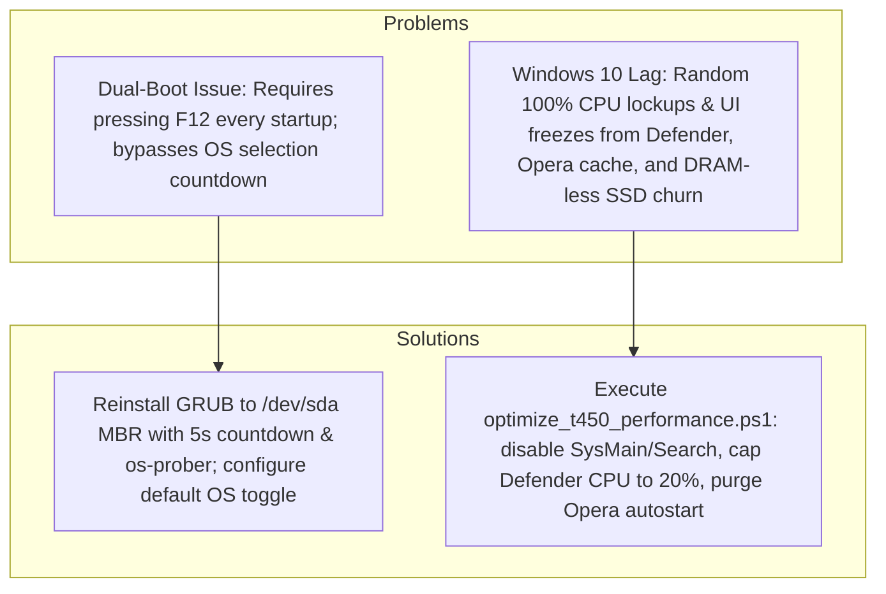

# ThinkPad T450 Dual-Boot & Windows 10 Performance Tuning Guide

[](https://www.lenovo.com)
[-blue.svg)](https://ark.intel.com)
[](https://linuxmint.com)
[-orange.svg)](https://www.kingston.com)
[-purple.svg)](https://learn.microsoft.com)

A battle-tested operational guide, automation scripts, and Standard Operating Procedures (SOP) for configuring seamless dual-boot (Windows 10 + Linux Mint) on the Lenovo ThinkPad T450 without pressing `F12` on startup, and eliminating 100% CPU lockups and DRAM-less SSD I/O freezes on Windows 10.

---

## Workstation Baseline Architecture

Telemetry captured from `LENOVO 20BUS02F0Z` (ThinkPad T450):

| Component | Specification | Operational Constraint |
| :--- | :--- | :--- |
| **Processor** | Intel Core i5-5300U @ 2.30 GHz (2 Cores / 4 Threads, 15W TDP) | Dual-core CPU easily saturates to 100% if background scanners (`MsMpEng.exe`) or browsers run unchecked. |
| **RAM** | 16 GB DDR3L | Ample memory headroom (RAM starvation is not a factor). |
| **Storage** | Kingston SA400S37480G (480GB SATA SSD) | **DRAM-less SSD** (Phison S11). Severe write latency spikes (up to 1000ms+) occur during background I/O churn. |
| **Firmware Mode** | Legacy BIOS / MBR Partitioning | Single MBR on Disk 0. Partition 2 is Windows NTFS (`C:`), Partition 4 is Linux Mint ext4. |
| **Fast Startup** | Disabled (`HiberbootEnabled = 0`) | Verified disabled; prevents NTFS filesystem locks across reboots. |

---

## Problem & Solution Overview



---

## Quick Start (The 2-Minute Solution)

### 1. Dual-Boot Fix (Execute in Linux Mint)
Boot into Linux Mint (press `F12` during startup), open Terminal (`Ctrl + Alt + T`), and run:

```bash
# Install GRUB to drive MBR and enable Windows 10 detection
sudo grub-install /dev/sda
echo "GRUB_DISABLE_OS_PROBER=false" | sudo tee -a /etc/default/grub

# Set 5-second countdown menu defaulting to Linux Mint
sudo sed -i 's/^GRUB_TIMEOUT=.*/GRUB_TIMEOUT=5/' /etc/default/grub
sudo sed -i 's/^GRUB_TIMEOUT_STYLE=.*/GRUB_TIMEOUT_STYLE=menu/' /etc/default/grub
sudo sed -i 's/^GRUB_DEFAULT=.*/GRUB_DEFAULT=0/' /etc/default/grub

# Apply and reboot
sudo update-grub
sudo reboot
```
*On reboot, the GRUB menu appears automatically with a 5-second countdown. No F12 required.*

---

### 2. Windows 10 Lag Remediation (Execute in Windows 10)
Open PowerShell as Administrator in the repository folder and run:

```powershell
# Preview changes without modifying system
powershell -ExecutionPolicy Bypass -File .\optimize_t450_performance.ps1 -DryRun

# Apply optimizations
powershell -ExecutionPolicy Bypass -File .\optimize_t450_performance.ps1
```

---

## Part 1: Dual-Boot Maintenance & Default OS Switching

All boot management is controlled in Linux Mint via `/etc/default/grub`.

### Method A: Linux Mint as Default (Current Setup)
Every cold boot starts with Linux Mint highlighted. After 5 seconds without user interaction, Linux Mint boots automatically.

```bash
sudo sed -i 's/^GRUB_DEFAULT=.*/GRUB_DEFAULT=0/' /etc/default/grub && sudo update-grub
```

---

### Method B: Windows 10 as Default
Every cold boot highlights Windows 10. After 5 seconds without user interaction, Windows 10 boots automatically.

```bash
WIN_ENTRY=$(grep -i -E "menuentry 'windows" /boot/grub/grub.cfg | head -n1 | cut -d"'" -f2)
sudo sed -i "s/^GRUB_DEFAULT=.*/GRUB_DEFAULT=\"$WIN_ENTRY\"/" /etc/default/grub && sudo update-grub
```

---

### Method C: Dynamic "Remember Last Booted OS" (Enterprise Best Practice)
The computer automatically boots whichever operating system was used last:
- Rebooting from Windows 10 reboots into Windows 10 automatically.
- Rebooting from Linux Mint reboots into Linux Mint automatically.
- You only need to touch the keyboard when you intentionally want to switch OS.

```bash
sudo sed -i 's/^GRUB_DEFAULT=.*/GRUB_DEFAULT=saved/' /etc/default/grub
grep -q "GRUB_SAVEDEFAULT=true" /etc/default/grub || echo "GRUB_SAVEDEFAULT=true" | sudo tee -a /etc/default/grub
sudo update-grub
```

---

## Part 2: Windows 10 Performance Optimization (Lag Remediation)

### Root Cause Analysis

1. **DRAM-less Kingston A400 SSD Contention**:
   The Phison S11 SSD controller lacks onboard DRAM cache. Windows background services (`SysMain` and `WSearch`) continuously write cache blocks to disk. During sustained random 4K write bursts, the controller's internal write buffer exhausts, spiking disk response times up to 1000ms+ and freezing the Windows GUI thread.
2. **Antimalware Service Executable (`MsMpEng.exe`)**:
   Windows Defender scans file writes in real time. Because Opera autostarts (`--autostart`) and continuously modifies cache files, Defender intercepts and scans these writes, saturating both physical cores of the i5-5300U processor.

### What `optimize_t450_performance.ps1` Does

- **Disables `SysMain` (Superfetch)**: Eliminates continuous background cache writes to the DRAM-less SSD.
- **Disables `WSearch` (Windows Search Indexer)**: Eliminates background disk indexing overhead.
- **Disables `DiagTrack`**: Stops background telemetry and diagnostic tracking.
- **Enforces NTFS TRIM**: Runs `fsutil behavior set DisableDeleteNotify 0` to preserve SSD flash endurance and garbage collection.
- **Caps Windows Defender CPU Ceiling to 20%**: Runs `Set-MpPreference -ScanAvgCPUMultithreaded 20` so background scans never dominate the dual-core CPU.
- **Adds Defender Exclusions**: Excludes `MsMpEng.exe` (stops self-scanning) and Opera browser cache directories.
- **Purges Opera Autostart**: Deletes the `Opera Air Stable` startup entry from `HKCU:\Software\Microsoft\Windows\CurrentVersion\Run`.

### Rollback Procedure
To revert all services, Defender preferences, and startup configurations back to factory Windows defaults:

```powershell
powershell -ExecutionPolicy Bypass -File .\rollback_t450_performance.ps1
```

---

## Part 3: Hardware & Thermal Throttling Triage

A notorious failure mode on the ThinkPad T450 is **BD PROCHOT throttling**, where the CPU locks permanently to **0.79 GHz (800 MHz)**:

### Verification Command (PowerShell)
```powershell
Get-CimInstance Win32_Processor | Select-Object Name, MaxClockSpeed, CurrentClockSpeed
```

- **Normal Behavior**: `CurrentClockSpeed` scales dynamically between ~1200 MHz at idle and 2300–2900 MHz under load.
- **Throttling Lock**: If `CurrentClockSpeed` is frozen at **798 MHz / 800 MHz** even under synthetic load:
  1. Inspect the laptop heatsink fin stack and fan for dust accumulation.
  2. Reapply thermal compound (Arctic MX-4 or MX-6) on the CPU heat spreader.
  3. Verify the Lenovo AC power adapter handshake (an unauthorized or degraded charger can trigger BD PROCHOT).
  4. Use ThrottleStop to uncheck `BD PROCHOT` if hardware sensors are tripping erroneously.

---

## Repository Index

```text
.
├── README.md                          # Master architecture guide and operations manual
├── LINUX_MINT_GRUB_SOP.md             # Dedicated Linux Mint GRUB configuration manual
├── optimize_t450_performance.ps1      # Windows 10 automated debloat & lag remediation script
├── rollback_t450_performance.ps1      # 1-Click rollback script to restore Windows defaults
└── SKILL.md                           # Antigravity custom skill specification
```

---

## License
MIT License. Open for personal and enterprise deployment.
